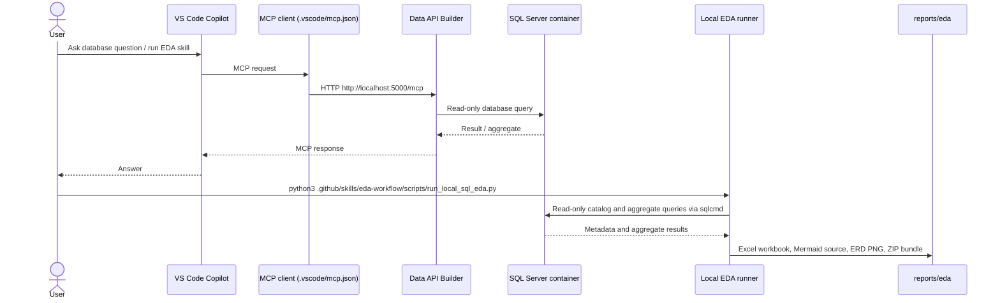

# AdventureWorks MCP and EDA

This workspace connects a local SQL Server `AdventureWorks2019` database to GitHub Copilot through Data API Builder (DAB) and MCP. It also includes a repeatable, read-only exploratory data analysis (EDA) workflow that writes Excel and ER diagram artifacts to `reports/eda/`.

## Architecture



MCP requests flow through DAB. The local EDA runner connects to SQL Server directly with the `sqlcmd` binary inside the Docker container; it does not run the analysis through MCP.

## Prerequisites

- Docker Desktop with the `sqlserver` container and AdventureWorks2019 database
- Visual Studio Code with GitHub Copilot Chat
- .NET SDK and Data API Builder (`dab`)
- Python 3
- Swift is used on macOS to render the ER diagram PNG

Check the tools:

```bash
docker --version
dotnet --version
dab --version
python3 --version
swift --version
```

## Database and Credentials

The expected local SQL endpoint is `localhost,1433`, database `AdventureWorks2019`.

`dab-config.template.json` is a safe template. Create `dab-config.json` only if it does not already exist, then set a valid SQL login and password:

```bash
cp dab-config.template.json dab-config.json
```

The template uses the least-privilege login name `mcp_readonly`; make sure that login exists in the local SQL Server and replace `REPLACE_WITH_LOCAL_PASSWORD` with its local password. The current local config may use a different login, so check which credentials are valid for your container.

Do not commit `dab-config.json`; it contains credentials and is ignored by `.gitignore`. Never put credentials in this README or in generated reports.

## Start SQL Server and DAB

Check that the database container is running:

```bash
docker ps
```

If it is stopped:

```bash
docker start sqlserver
```

Validate and start DAB from the project root:

```bash
dab validate --config dab-config.json
dab start --config dab-config.json
```

Keep the DAB terminal running. DAB's health endpoint is `http://localhost:5000/`; the MCP endpoint is `http://localhost:5000/mcp`.

## Connect VS Code Copilot to MCP

The workspace MCP server is configured in `.vscode/mcp.json`:

```json
{
  "servers": {
    "adventureworks-dab": {
      "type": "http",
      "url": "http://localhost:5000/mcp"
    }
  }
}
```

Open Copilot Chat in Agent mode and confirm the server is started/available. The enabled MCP tools are `describe_entities`, `read_records`, and `aggregate_records`. Create, update, delete, and procedure-execution tools are disabled. Entity permissions are read-only.

Example prompt:

```text
List the AdventureWorks MCP tools, then count rows in Sales_Customer.
```

## Run EDA

The reusable workspace skill is `.github/skills/eda-workflow/SKILL.md`. Invoke `/eda-workflow` in Copilot Chat to follow the guided workflow. To generate the current local database report directly, from the workspace root run:

```bash
python3 .github/skills/eda-workflow/scripts/run_local_sql_eda.py
```

The helper reads the local ignored `dab-config.json`, invokes read-only catalog/aggregate queries via `sqlcmd` inside the `sqlserver` container, and does not execute stored procedures. No raw person-level rows are exported. The PHI review is a schema/name risk screen, not a HIPAA compliance determination.

The workbook has separate tabs for Overview, Object Inventory, Fields and Types, Data Quality, PHI Review, Incremental Load, Patterns, Relationships, and Limitations. Patterns include category breakdowns (for example country/state codes, gender codes, and units of measure): total non-null rows, distinct categories, category counts, and percentages. Low-cardinality categories are listed fully; high-cardinality columns show the top values and a combined `Other categories` row.

## EDA Outputs

Generated files are in `reports/eda/`:

- `AdventureWorks2019-eda-findings-<timestamp>.xlsx` — latest detailed workbook; older EDA workbooks are removed on each run
- `AdventureWorks2019-er-diagram.png` — stable ERD image; reused unless the relationship diagram changes
- `AdventureWorks2019-er-diagram.mmd` — stable Mermaid source for the ERD
- `AdventureWorks2019-eda-download-YYYYMMDD.zip` — refreshed bundle with the latest workbook and ERD files

The ER diagram is based on declared foreign keys, not guessed relationships. The full database diagram is dense; use the workbook's Relationships tab to inspect individual From/To table and column mappings.

## Privacy and Interpretation

- EDA is read-only. No database objects or rows are modified.
- Sensitive values such as names, contact details, birth dates, password data, or payment-card values are not exported.
- For categorical fields, labels and aggregate counts are shown only for selected low-cardinality domains; omit/suppress a domain if small groups could identify individuals.
- Distinct counts are not proof of uniqueness unless a PK/unique constraint or business rule confirms it.
- Timestamp columns are candidates for incremental loads, not proof of a production-ready watermark. Confirm update behavior, timezone, late-arriving records, and delete capture.
- Row-grain descriptions are examples based on schema, keys, and AdventureWorks semantics; confirm business definitions with data owners.

## Troubleshooting

`dab: command not found`:

```bash
echo 'export PATH="$PATH:$HOME/.dotnet/tools"' >> ~/.zprofile
source ~/.zprofile
dab --version
```

MCP connection fails:

1. Confirm `docker ps` shows `sqlserver` and port `1433`.
2. Confirm `dab start --config dab-config.json` is still running.
3. Check the DAB health URL `http://localhost:5000/` and MCP URL `http://localhost:5000/mcp`.
4. Confirm `.vscode/mcp.json` uses the `/mcp` path.

EDA runner fails:

1. Confirm Docker is running and `sqlserver` is up.
2. Confirm `dab-config.json` points at `AdventureWorks2019` with valid local SQL credentials.
3. Check `python3 --version` and `swift --version`; Swift is needed to render the PNG when the ERD changes.